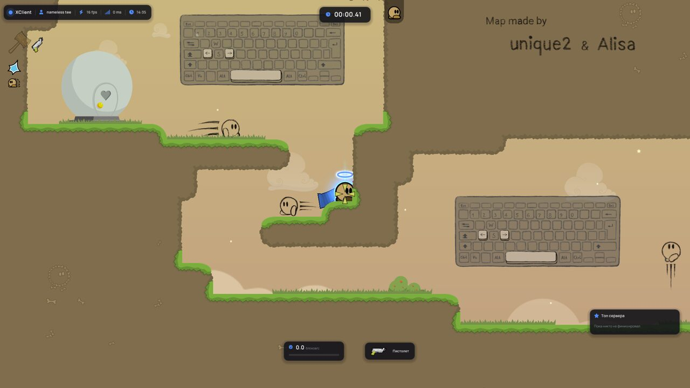
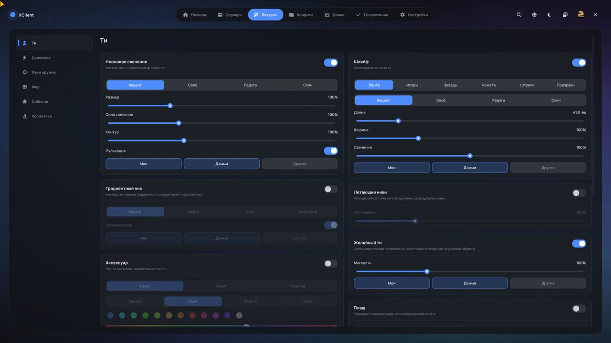
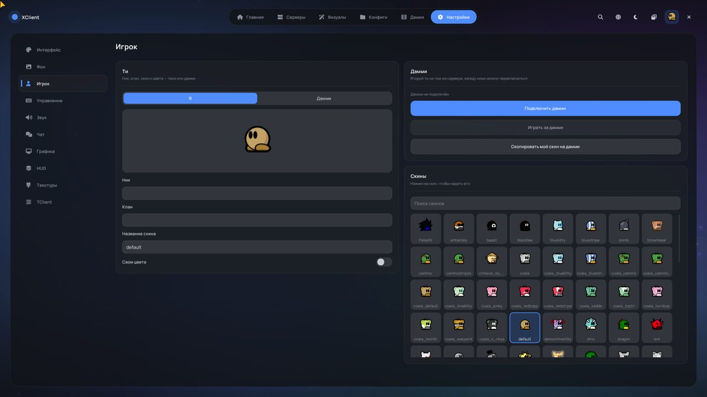
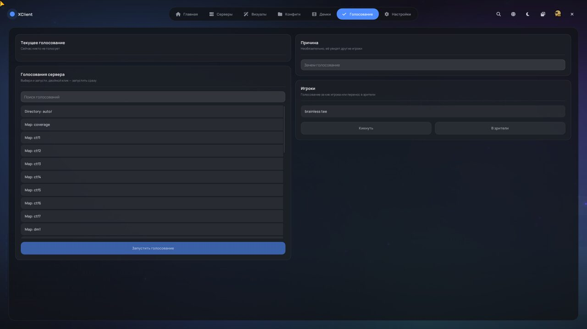

<div align="center">

# ✦ XClient

**Красивый клиент для DDNet в стиле Minecraft-клиентов**

Новое меню, новый HUD, свечение и эффекты почти на всё — и при этом обычная DDNet без читов.

`Windows` · `OpenGL 3.3 / Vulkan` · `RU / EN`

</div>

> **Изменённая версия / Altered version.** XClient — неофициальный модифицированный форк
> [TClient](https://github.com/sjrc6/TaterClient-ddnet), который основан на [DDNet](https://github.com/ddnet/ddnet).
> Это не оригинальный TClient и не DDNet. Название проекта рабочее.
> This is an unofficial altered fork of TClient/DDNet and is not the original software (zlib license, clause 2).



---

## Что это

XClient — клиент для [DDraceNetwork](https://ddnet.org), сделанный по образцу клиентов для Minecraft
(Nursultan, Expensive, Space Visuals). Игра, физика и сеть остались как в DDNet: XClient играет на любых
серверах DDNet. Поверх добавлены новое меню, новый HUD и визуальные эффекты.

**Главное правило: никаких читов.** Ни ботов, ни автохука, ни авто-фейза, ни ESP. Только внешний вид, HUD и
удобство. Всё, что делает XClient, видишь только ты.

## Возможности

### 🖥 Новое меню
Меню полностью заменяет стандартное и открывается по <kbd>Esc</kbd>.

- **Вкладки:** Главная · Серверы · Визуалы · Конфиги · Демки · Голосование · Настройки.
- **Карточки настроек** в две колонки, как в Space Visuals: тоглы, слайдеры, переключатели, всё анимировано.
- **Оформление:** тёмная и светлая тема, 7 цветов акцента, шрифты Manrope / Onest / Unbounded, масштаб под 1080p / 2K / 4K.
- **Фон меню:** анимированный, блюр игры, карта или своя картинка / гифка.
- **Удобство:** поиск по всем настройкам (<kbd>Ctrl</kbd>+<kbd>F</kbd>), звуки интерфейса, уведомления-тосты.
  Меню запоминает, где ты его закрыл.
- **Главная:** профиль со статистикой с ddnet.org, друзья онлайн, новости, информация о карте (маппер, сложность, топ).
- **Серверы:** карточки серверов с фильтрами Novice / Moderate / Brutal / Insane, избранное и поиск.
- **Конфиги:** сохранение настроек и обмен ими коротким кодом. Чужой код меняет только настройки XClient.
- **Демки:** просмотр, переименование и удаление.
- **Игрок:** скины и цвета для себя и для дамми; дамми подключается и переключается прямо из меню.
- **Голосование:** голосовать за/против, запускать голосования сервера, кик и перенос в зрители.
- **TClient:** все настройки TClient собраны в одном разделе.

<p align="center">
  
  
</p>

### ✨ Визуалы
Почти у каждого эффекта есть свой цвет (акцент / свой / радуга / цвет скина), сила свечения и выбор, для кого
его показывать: **Мои / Дамми / Другие**.

| Раздел | Что есть |
|---|---|
| **Ти** | неоновый контур, шлейф (лента / искры / звёзды / комета / штрихи / призраки), плащ и шарф с физикой ткани, нимб / корона / China Hat, желейный ти, градиентные и «летающие» ники |
| **Движение** | круги при прыжке и приземлении, пыль при беге |
| **Хук и оружие** | светящийся хук и цветная цепь, эффект зацепа, удар молотком, взрыв гранаты (волна / неон / искры), светящиеся пули и лазеры, свой прицел |
| **Мир** | погода (снег, листья, сакура, пепел), летающие 3D-огоньки, свечение предметов, цвет мира, виньетка, тонкая настройка свечения |
| **События** | конфетти и салют на финише, плашка рекорда, эффекты смерти и появления, вспышки на чекпоинтах и телепортах, стрелки на дамми, напарников и друзей за экраном, звуки событий, тряска камеры |
| **Косметика** | свои шапки из любой png / gif: двигаешь и крутишь прямо на ти, 6 встроенных + крылья |

Стандартные эффекты DDNet (дым, брызги, лазеры) можно заменить своими. Пресеты производительности
**Низкое / Среднее / Высокое** выключают тяжёлые эффекты одним кликом.

### 📊 HUD
- Плашки в стиле меню: ватермарка (ник, FPS, пинг, время), таймер с сотыми, скорость, оружие, музыка,
  нажатые клавиши, мини-топ сервера.
- **Редактор HUD:** перетаскиваешь элементы мышкой, колесом меняешь размер.
- Своя таблица игроков по <kbd>Tab</kbd>, чат и килфид в стиле меню, колесо эмоций, плашки под никами.
- Режим фокуса: на экране остаются только таймер и скорость.
- **Музыкальный плеер:** показывает и переключает то, что играет в браузере (YouTube, SoundCloud, Яндекс Музыка)
  или в Spotify.

<p align="center">
  
</p>

### 🗺 Редактор карт «как Фотошоп»
- Тёмный плоский интерфейс, слева инструменты, справа слои. Панели можно перетаскивать.
- Инструменты как в Фотошопе: кисть <kbd>B</kbd>, ластик <kbd>E</kbd>, заливка <kbd>G</kbd>, пипетка <kbd>I</kbd>,
  рука <kbd>H</kbd>, лупа <kbd>Z</kbd>. Есть линейки и направляющие, настройки по <kbd>Ctrl</kbd>+<kbd>K</kbd>.
- **GIF прямо в карту:** анимация играет у всех игроков на любом клиенте.
- Пресеты анимаций как в After Effects: покачивание, вращение, парение, мигание, радуга…
- Картинки jpg / bmp / gif / tga подхватываются без конвертации. Увеличение ×2 / ×4 для пиксель-арта.
- Гид по редактору для новичков.

---

## Как запустить

### Готовая сборка
1. Распакуй архив в любую папку (не запускай прямо из zip).
2. Запусти `DDNet.exe`.
3. Если Windows пишет «Система Windows защитила ваш компьютер», нажми **Подробнее → Выполнить в любом случае**.
4. Если не хватает `VCRUNTIME140.dll`, поставь
   [Microsoft Visual C++ Redistributable x64](https://aka.ms/vs/17/release/vc_redist.x64.exe).

В архиве должны быть `DDNet.exe`, `DDNet-Server.exe` (для локального сервера), папка `data` и все `.dll`.

### Сборка из исходников (Windows)
Понадобятся: [Visual Studio 2022](https://visualstudio.microsoft.com/) с «Разработкой классических приложений на C++»,
[Git](https://git-scm.com/) и [Rust](https://rustup.rs/).

```sh
git clone --recursive https://github.com/rickrollru/KeyClient
```

1. Открой папку проекта в Visual Studio (**Файл → Открыть → Папка**).
2. Вверху выбери конфигурацию **XClient Release** (для игры) или **XClient Debug** (для поиска ошибок).
3. Дождись в окне «Вывод» строки «Создание CMake завершено».
4. **Сборка → Собрать всё** (<kbd>Ctrl</kbd>+<kbd>Shift</kbd>+<kbd>B</kbd>). Игра появится в папке `build-release`.
5. Запуск — зелёная кнопка **▶ DDNet.exe**.

Если сборка ведёт себя странно: **Проект → Удалить кэш и перенастроить**, потом **Сборка → Перестроить всё**.

### Linux
Сборка как у DDNet ([инструкция](https://github.com/ddnet/ddnet#cloning)):

```sh
mkdir build && cd build
cmake .. -G Ninja && ninja game-client game-server
```

---

## Настройки и команды

Настройки XClient начинаются с `xc_` и хранятся в `settings_xclient.cfg` в папке DDNet
(`%APPDATA%\DDNet` на Windows). Обычно всё настраивается через меню, но есть и консоль (<kbd>F1</kbd>):

| Команда | Что делает |
|---|---|
| `xc_menu` | открыть / закрыть новое меню |
| `xc_new_menu 0` / `1` | старое / новое меню (в старом меню есть кнопка **XClient**, чтобы вернуться) |
| `xc_hud_edit` | редактор HUD |
| `xc_focus` | режим фокуса |
| `xc_music_play_pause`, `xc_music_next`, `xc_music_prev` | управление музыкой |
| `xc_editor_style 1; xc_editor_layout 1` | вернуть новый вид редактора карт |

## Для разработчиков

| Где | Что |
|---|---|
| `src/game/client/components/xclient/` | весь код XClient: эффекты, HUD, музыка |
| `…/xclient/ui/` | новое меню на Dear ImGui |
| `…/xclient/hud/` | HUD, таблица игроков, редактор HUD |
| `…/xclient/editor/` | редактор карт «как Фотошоп» |
| `src/engine/client/backend/xclient/` | рендер-модуль OpenGL 3.3: SDF-фигуры, bloom, блюр |
| `src/engine/shared/config_variables_xclient.h` | все настройки `xc_*` |
| `data/xclient/` | шрифты, звуки, текстуры эффектов, шапки |
| `CLAUDE.md` | ТЗ и журнал разработки |

Вставки XClient в файлы DDNet / TClient помечены комментарием `// XClient`.
Документация оригинального TClient: [docs/tclient/README_TClient.md](docs/tclient/README_TClient.md).

## Спасибо и лицензии

- [DDNet](https://github.com/ddnet/ddnet) и [TClient](https://github.com/sjrc6/TaterClient-ddnet) — основа клиента,
  лицензия zlib ([license.txt](license.txt)).
- [Dear ImGui](https://github.com/ocornut/imgui) — MIT; [stb_image](https://github.com/nothings/stb) — public domain / MIT.
- Шрифты [Manrope](https://fonts.google.com/specimen/Manrope), [Onest](https://fonts.google.com/specimen/Onest),
  [Unbounded](https://fonts.google.com/specimen/Unbounded) — SIL OFL; иконки [Font Awesome](https://fontawesome.com) Free.
- Текстуры эффектов «мягкий свет» — из клиента Flower, с разрешения автора (Кент)
  ([CREDITS](data/xclient/fx/CREDITS.txt)).
- Идеи из MC client и Minecraft-клиентов, код написан заново.

<div align="center">

Сделано Максом (**Крутой**) · Discord: `rickroll.ru`

</div>
