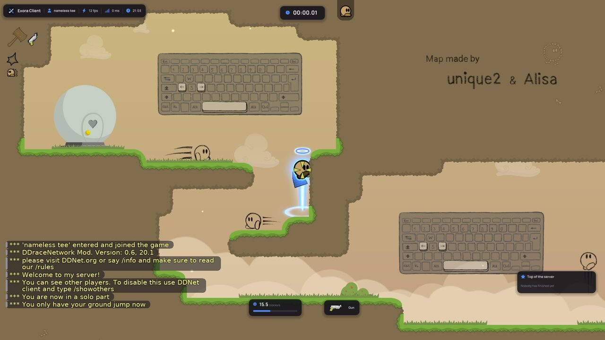
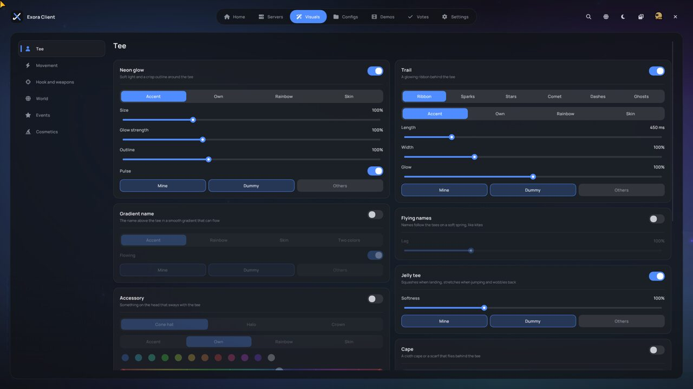
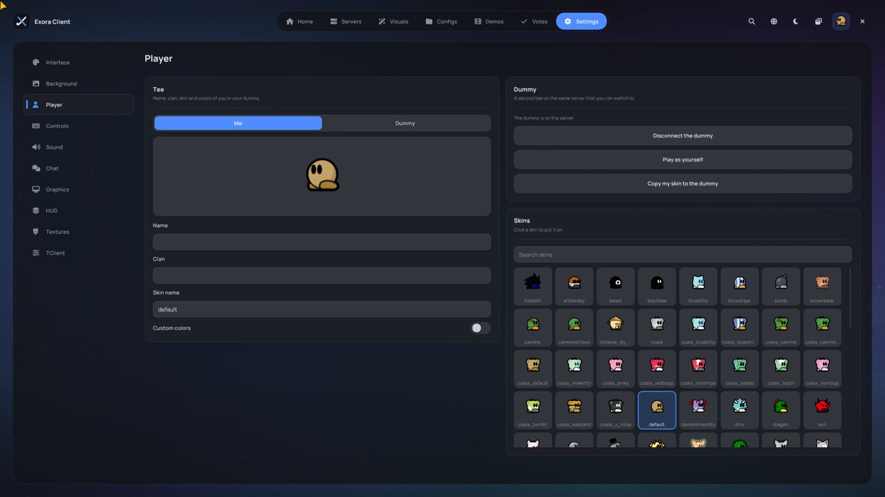
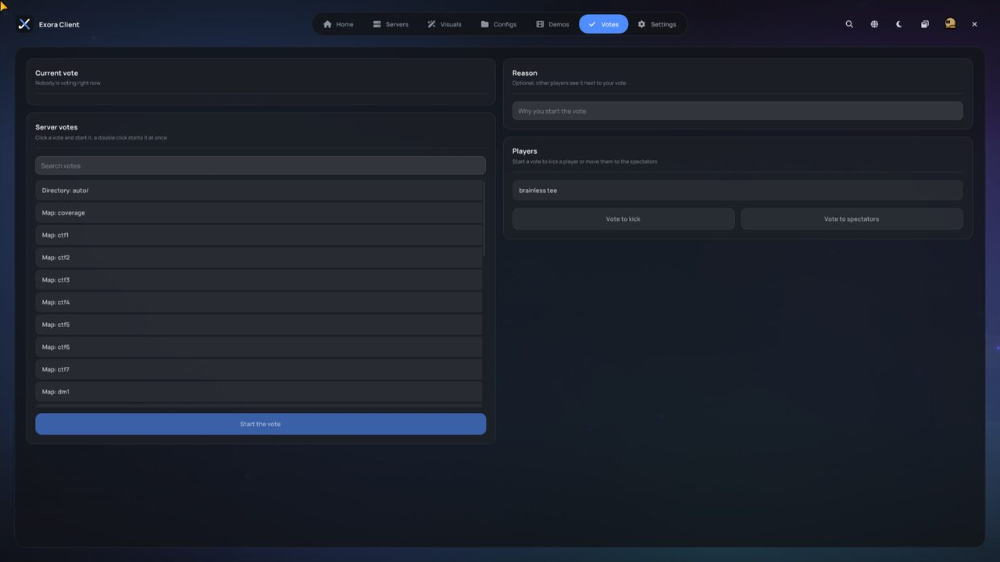

<div align="center">


# Exora Client

**A beautiful client for DDNet**

A new menu, a new HUD, glow and effects on almost everything — and still plain DDNet with no cheats.

`Windows` · `OpenGL 3.3 / Vulkan` · `EN / RU`

**English** · [Русский](README.ru.md)

</div>

> **Altered version.** Exora Client is an unofficial modified fork of
> [TClient](https://github.com/sjrc6/TaterClient-ddnet), which is based on [DDNet](https://github.com/ddnet/ddnet).
> It is not the original TClient or DDNet software (zlib license, clause 2).



---

## What it is

Exora Client is a client for [DDraceNetwork](https://ddnet.org) with a modern look. The game, physics and network code
are the same as in DDNet, so Exora Client plays on any DDNet server. On top of that it adds a new menu, a new HUD and
visual effects.

**The main rule: no cheats.** No bots, no auto-hook, no auto-phase, no ESP. Only looks, HUD and quality of life.
Everything Exora Client draws is visible only to you.

## Features

### 🖥 New menu
The menu fully replaces the default one and opens with <kbd>Esc</kbd>.

- **Tabs:** Home · Servers · Visuals · Configs · Demos · Votes · Settings.
- **Settings cards** in two columns: toggles, sliders, segmented switches, all animated.
- **Look:** dark and light themes, 7 accent colors, Manrope / Onest / Unbounded fonts, scaling for 1080p / 2K / 4K.
- **Menu background:** animated, blurred game, a map or your own picture / gif.
- **Comfort:** search through all settings (<kbd>Ctrl</kbd>+<kbd>F</kbd>), UI sounds, toast notifications.
  The menu remembers where you closed it.
- **Home:** profile with ddnet.org stats, friends online, news, map info (mapper, difficulty, top times).
- **Servers:** server cards with Novice / Moderate / Brutal / Insane filters, favorites and search.
- **Configs:** save your settings and share them with a short code. Imported codes only change Exora Client settings.
- **Demos:** watch, rename and delete.
- **Player:** skins and colors for you and your dummy; connect and switch to the dummy right from the menu.
- **Votes:** vote yes / no, start server votes, kick or move players to spectators.
- **TClient:** all TClient settings in one section.

<p align="center">
  
  
</p>

### ✨ Visuals
Almost every effect has its own color (accent / custom / rainbow / skin color), glow strength and a choice of who
it is shown for: **Me / Dummy / Others**.

| Section | What's inside |
|---|---|
| **Tee** | neon outline, trail (ribbon / sparks / stars / comet / dashes / ghosts), cape and scarf with cloth physics, halo / crown / China Hat, jelly tee, gradient and "flying" name plates |
| **Movement** | circles on jump and landing, dust when running |
| **Hook and weapons** | glowing hook and colored chain, hook hit effect, hammer hit, grenade explosion (shockwave / neon / sparks), glowing bullets and lasers, custom crosshair |
| **World** | weather (snow, leaves, sakura, ash), floating 3D lights, item glow, world tint, vignette, fine glow settings |
| **Events** | confetti and fireworks on finish, record banner, death and spawn effects, flashes on checkpoints and teleports, arrows to your dummy, teammates and friends off screen, event sounds, camera shake |
| **Cosmetics** | your own hats from any png / gif: move and rotate them right on the tee, 6 built-in hats + wings |

Default DDNet effects (smoke, splashes, lasers) can be replaced with our own. Performance presets
**Low / Medium / High** turn heavy effects off in one click.

### 📊 HUD
- Plates in the menu style: watermark (name, FPS, ping, time), timer with hundredths, speed, weapon, music,
  pressed keys, server mini-top.
- **HUD editor:** drag elements with the mouse, resize with the wheel.
- Custom scoreboard on <kbd>Tab</kbd>, chat and kill feed in the menu style, emote wheel, name plates.
- Focus mode: only the timer and speed stay on screen.
- **Music player:** shows and controls what plays in your browser (YouTube, SoundCloud, Yandex Music) or Spotify.

<p align="center">
  
</p>

### 🗺 Map editor
- A new Figma-style interface: menus on top, layer tree on the left, properties on the right, a tool capsule at the
  bottom. Command palette on <kbd>Ctrl</kbd>+<kbd>K</kbd>, its own open / save file dialog.
- Photoshop-like tools: brush <kbd>B</kbd>, eraser <kbd>E</kbd>, fill <kbd>G</kbd>, eyedropper <kbd>I</kbd>,
  hand <kbd>H</kbd>, zoom <kbd>Z</kbd>. Rulers and guides, preferences on <kbd>Ctrl</kbd>+<kbd>,</kbd>.
- **GIFs right into the map:** the animation plays for every player on any client.
- After Effects-like animation presets: sway, spin, float, blink, rainbow…
- jpg / bmp / gif / tga images work without converting. ×2 / ×4 upscaling for pixel art.
- An editor guide for beginners.

---

## How to run

### Ready build
1. Unpack the archive into any folder (don't run it straight from the zip).
2. Run `DDNet.exe`.
3. If Windows says "Windows protected your PC", click **More info → Run anyway**.
4. If `VCRUNTIME140.dll` is missing, install
   [Microsoft Visual C++ Redistributable x64](https://aka.ms/vs/17/release/vc_redist.x64.exe).

The archive must contain `DDNet.exe`, `DDNet-Server.exe` (for the local server), the `data` folder and all `.dll` files.

### Building from source (Windows)
You need [Visual Studio 2022](https://visualstudio.microsoft.com/) with "Desktop development with C++",
[Git](https://git-scm.com/) and [Rust](https://rustup.rs/).

```sh
git clone --recursive https://github.com/rickrollru/KeyClient
```

1. Open the project folder in Visual Studio (**File → Open → Folder**).
2. At the top pick the **Exora Client Release** configuration (for playing) or **Exora Client Debug** (for finding bugs).
3. Wait for "CMake generation finished" in the Output window.
4. **Build → Build All** (<kbd>Ctrl</kbd>+<kbd>Shift</kbd>+<kbd>B</kbd>). The game appears in the `build-release` folder.
5. Run it with the green **▶ DDNet.exe** button.

If the build acts strange: **Project → Delete Cache and Reconfigure**, then **Build → Rebuild All**.

### Linux
Same as DDNet ([instructions](https://github.com/ddnet/ddnet#cloning)):

```sh
mkdir build && cd build
cmake .. -G Ninja && ninja game-client game-server
```

---

## Settings and commands

Exora Client settings start with `xc_` and are stored in `settings_xclient.cfg` in the DDNet folder
(`%APPDATA%\DDNet` on Windows). Usually everything is set up in the menu, but there is also the console (<kbd>F1</kbd>):

| Command | What it does |
|---|---|
| `xc_menu` | open / close the new menu |
| `xc_new_menu 0` / `1` | old / new menu (the old menu has an **Exora Client** button to come back) |
| `xc_hud_edit` | HUD editor |
| `xc_focus` | focus mode |
| `xc_music_play_pause`, `xc_music_next`, `xc_music_prev` | music control |
| `xc_editor_ui 0` / `1` | classic / new map editor |

## For developers

| Where | What |
|---|---|
| `src/game/client/components/xclient/` | all Exora Client code: effects, HUD, music |
| `…/xclient/ui/` | the new menu on Dear ImGui |
| `…/xclient/hud/` | HUD, scoreboard, HUD editor |
| `…/xclient/editor/` | the new map editor |
| `src/engine/client/backend/xclient/` | OpenGL 3.3 render module: SDF shapes, bloom, blur |
| `src/engine/shared/config_variables_xclient.h` | all `xc_*` settings |
| `data/xclient/` | fonts, sounds, effect textures, hats |
| `docs/xclient/logo/` | logo files |

Exora Client changes in DDNet / TClient files are marked with a `// XClient` comment (the project's name in the code).
The original TClient documentation: [docs/tclient/README_TClient.md](docs/tclient/README_TClient.md).

## Thanks and licenses

- [DDNet](https://github.com/ddnet/ddnet) and [TClient](https://github.com/sjrc6/TaterClient-ddnet) — the base of the
  client, zlib license ([license.txt](license.txt)).
- [Dear ImGui](https://github.com/ocornut/imgui) — MIT; [stb_image](https://github.com/nothings/stb) — public domain / MIT.
- Fonts [Manrope](https://fonts.google.com/specimen/Manrope), [Onest](https://fonts.google.com/specimen/Onest),
  [Unbounded](https://fonts.google.com/specimen/Unbounded) — SIL OFL; icons [Font Awesome](https://fontawesome.com) Free.
- "Soft light" effect textures — from the Flower client, with the author's permission
  ([CREDITS](data/xclient/fx/CREDITS.txt)).

<div align="center">

Made by Max (**Krutoy**) · Discord: `rickroll.ru`

</div>
